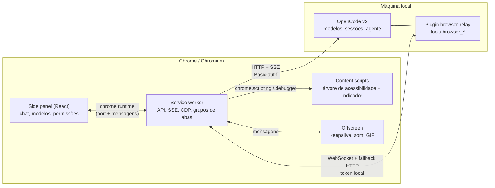
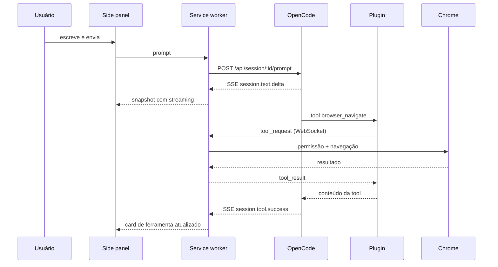
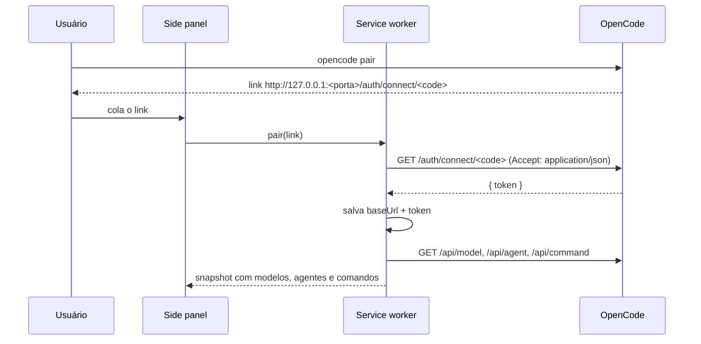
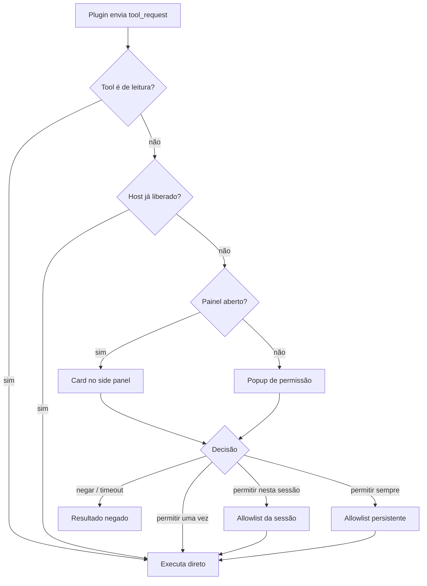

# Arquitetura

O sistema tem três processos/contextos:

| Componente | Responsabilidade | Tecnologia | Endereço |
|---|---|---|---|
| **Extensão** | UI, sessões, streaming, execução das ações no navegador | TypeScript, React 19, MV3 | `chrome-extension://<id>` |
| **OpenCode local** | Modelos, sessões, agente, histórico, SSE | OpenCode v2 (API HTTP) | `http://127.0.0.1:<porta>` |
| **Plugin `browser-relay`** | Registra as tools `browser_*` e faz a ponte com a extensão | TypeScript no runtime do OpenCode | `ws://127.0.0.1:8799` (ou 8800–8802) |

## Fluxo de uma conversa

## Fluxo de pareamento

## Fluxo de ferramenta e permissão

## Camadas da extensão

| Camada | Arquivos | Papel |
|---|---|---|
| Background | `src/background/**` | Cliente do OpenCode, SSE, relay, CDP, grupos de abas, permissões, registro de tools |
| Conteúdo | `src/content/**` | Árvore de acessibilidade com refs, ações de DOM, indicador visual e botão Parar |
| UI | `src/sidepanel`, `src/options`, `src/permission` | Chat, configurações e popup de permissão |
| Offscreen | `src/offscreen.ts` | Keepalive do service worker, aviso sonoro e codificação de GIF |
| Compartilhado | `src/shared/**` | Tipos, protocolo do relay, armazenamento |

## Decisões registradas

As escolhas estruturais estão em [adr/](adr/): MV3 + side panel, pareamento por
link, plugin local com relay, permissões por ação/domínio, CDP com fallback,
grupos de abas por sessão, ranking opcional no `find` e GIF no offscreen.
