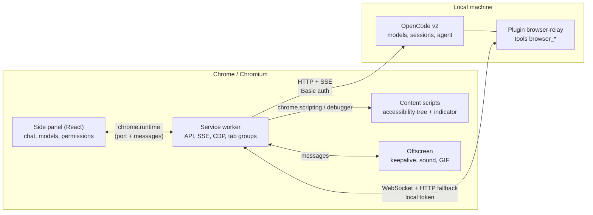
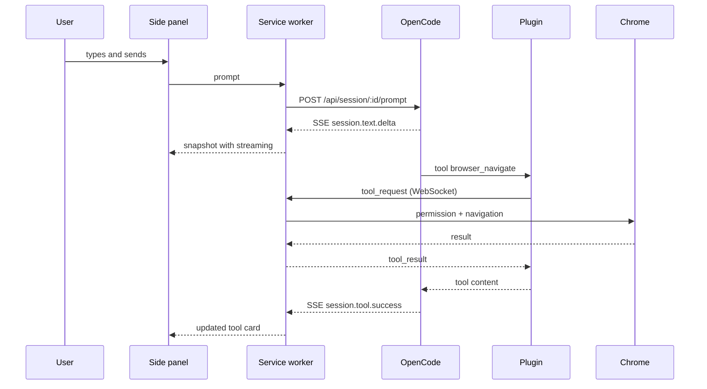
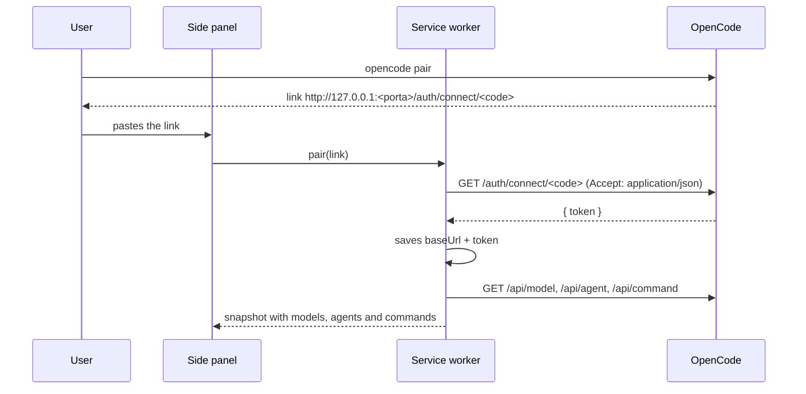
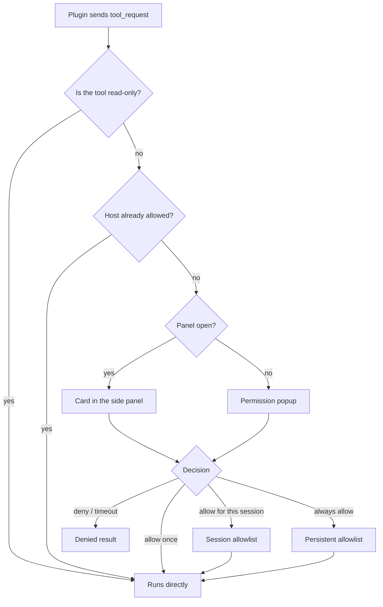

# Architecture

The system has three processes/contexts:

| Component | Responsibility | Technology | Address |
|---|---|---|---|
| **Extension** | UI, sessions, streaming, execution of actions in the browser | TypeScript, React 19, MV3 | `chrome-extension://<id>` |
| **Local OpenCode** | Models, sessions, agent, history, SSE | OpenCode v2 (HTTP API) | `http://127.0.0.1:<port>` |
| **`browser-relay` plugin** | Registers the `browser_*` tools and bridges to the extension | TypeScript in the OpenCode runtime | `ws://127.0.0.1:8799` (or 8800–8802; reuses an already active relay) |

> OpenCode v2 ships the native `opencode.browser` plugin (the desktop app's
> browser) with the `browser.tabs.close` operation, exposed as
> `browser_tabs_close`. To avoid a collision, this project's equivalent tool is
> `browser_tabs_close_tab` (wire name `tabs_close`).

## Conversation flow

## Pairing flow

## Tool and permission flow

## Extension layers

| Layer | Files | Role |
|---|---|---|
| Background | `src/background/**` | OpenCode client, SSE, relay, CDP, tab groups, permissions, tool registry |
| Content | `src/content/**` | Accessibility tree with refs, DOM actions, visual indicator and Stop button |
| UI | `src/sidepanel`, `src/options` | Chat and settings; permission is a modal inside the panel |
| Offscreen | `src/offscreen.ts` | Service worker keepalive, notification sound and GIF encoding |
| Shared | `src/shared/**` | Types, relay protocol, storage |

## Recorded decisions

The structural choices are in [adr/](../../adr/): MV3 + side panel, link-based
pairing, local plugin with a relay, per-action/domain permissions, CDP with a
fallback, per-session tab groups, optional ranking in `find` and GIF in the
offscreen document.
