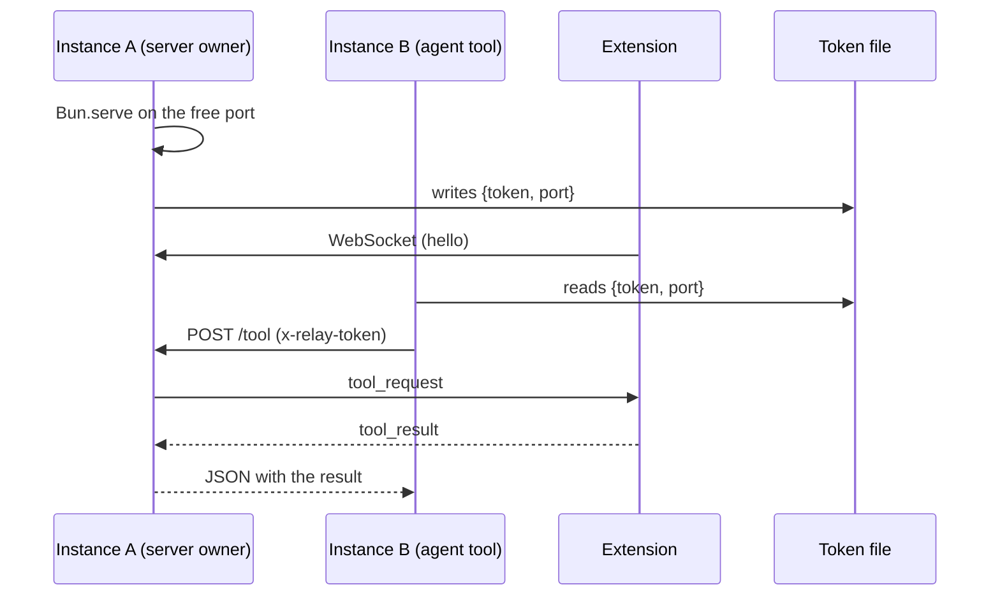

# OpenCode plugin (`browser-relay`)

File: `plugin/browser-relay.ts`
Install: `npm run install:plugin` copies the relay and the
`opencode-browser.agent.md` template into `~/.config/opencode/plugins/` (and
removes the old `opencode-browser.ts` copy, if present). After installing,
restart the service (`opencode service restart`) to load the new relay and
agent.

> Keep **only one** copy of the plugin in `~/.config/opencode/plugins/`. Two
> copies declare the same `opencode.browser-relay` id and OpenCode registers one
> of them as failed.

OpenCode loads local plugins automatically and reloads when it detects changes
to the file.

## What it does

1. Starts a WebSocket server on loopback to receive the extension.
2. Creates the conversations folder (`~/.opencode-browser-extensions`) and
   announces `home` and `workspace` in the `ready` handshake, **after** a valid
   `hello`.
3. Ensures the `opencode-browser` agent in the global OpenCode configuration
   (`~/.config/opencode/agents/`) from the
   `plugin/opencode-browser.agent.md` template, creating or updating it by
   version (see [Browser agent](#browser-agent)).
4. Registers the 18 `browser_*` tools in the `browser` namespace (with
   `codemode: false`, so they show up in the model's native tool list).
5. When the model calls a tool, sends a `tool_request` to the extension and
   waits for `tool_result` (180 s timeout). If the extension is reconnecting, it
   waits up to 8 s before failing.
6. Converts returned images (base64) into file content for the model and saves
   each one to `~/.cache/opencode-browser/capturas/` (or `$XDG_CACHE_HOME`),
   returning the path in the response text — the agent needs the file, not just
   the image in the conversation, to build pages that embed the screen.

## Browser agent

The plugin creates the `opencode-browser` primary agent in the global OpenCode
configuration from the `plugin/opencode-browser.agent.md` template, which is
installed alongside the plugin. The file is updated **by version**:

- does not exist → it is created from the template;
- has the `<!-- opencode-browser-agent vN -->` marker with a version lower than
  the template's → the plugin backs it up (`.bak-vN`) and writes the new version;
- has no marker (the user removed it) or is already at the template version →
  it is preserved, including manual edits.

The current template is **v5**, written in English, and includes security rules (prompt injection),
extension environment limitations, tabs by origin, context economy and the
correct tool names. To customize, edit
`~/.config/opencode/agents/opencode-browser.md`; to return to the default,
delete the file and restart OpenCode.

> The tool that closes a tab is `browser_tabs_close_tab` (wire name
> `tabs_close`). The name `browser_tabs_close` collides with
> `browser.tabs.close` from the native `opencode.browser` plugin and disappears
> from the model catalog.

```text
~/.config/opencode/agents/opencode-browser.md            (Linux/macOS)
%USERPROFILE%\.config\opencode\agents\opencode-browser.md (Windows)
$XDG_CONFIG_HOME/opencode/agents/opencode-browser.md      (when defined)
```

The file uses OpenCode's V2 frontmatter:

```yaml
mode: primary
permissions:
  - action: "*"
    resource: "*"
    effect: deny
  - action: "browser"
    resource: "*"
    effect: allow
  - action: "browser_*"
    resource: "*"
    effect: allow
  - action: question
    resource: "*"
    effect: allow
  - action: doom_loop
    resource: "*"
    effect: ask
```

In practice, the agent only sees the browser tools and `question`: `read`,
`edit`, `shell`, `glob`, `grep`, `webfetch` and the like are blocked, so it
cannot touch files or machine data outside the pages. The Markdown body (v5)
covers security/prompt injection, extension environment limitations, tabs by
origin, context economy and confirmation before destructive actions.

The extension requests the write via `ensure_agent` whenever the relay connects
or the configuration changes and, when the agent appears in `GET /api/agent`,
starts using it as the default (`defaultAgent`) if the user has not chosen
another one yet.

> Being global, the agent appears in every OpenCode project, not only in
> extension conversations. If the server does not refresh the list on its own,
> restart `opencode` after updating the plugin.

## Platforms

The plugin uses only Node/Bun APIs (`os.homedir()`, `path.join`, `node:fs`,
`node:crypto`), so it works the same on Linux, macOS and Windows. The paths
involved:

| Item | Linux | macOS | Windows |
|---|---|---|---|
| OpenCode plugins | `~/.config/opencode/plugins` | `~/.config/opencode/plugins` | `%USERPROFILE%\.config\opencode\plugins` |
| OpenCode agents | `~/.config/opencode/agents` | `~/.config/opencode/agents` | `%USERPROFILE%\.config\opencode\agents` |
| Conversations folder | `~/.opencode-browser-extensions` | `~/.opencode-browser-extensions` | `%USERPROFILE%\.opencode-browser-extensions` |
| Token file | `$XDG_RUNTIME_DIR/opencode-browser/relay.json` or `~/.cache/opencode-browser/relay.json` | same | `%USERPROFILE%\.cache\opencode-browser\relay.json` |

`XDG_CONFIG_HOME`, `XDG_DATA_HOME`, `XDG_CACHE_HOME`, `XDG_STATE_HOME` and
`XDG_RUNTIME_DIR` are respected when defined (on any system). Plugin
installation is done by `npm run install:plugin`
(`scripts/install-plugin.mjs`), which resolves those paths without depending on
a POSIX shell.

## Local server

| Route | Method | Authentication | Description |
|---|---|---|---|
| `/` or `/ws` | `GET` (upgrade) | Extension `Origin` + `hello` | WebSocket channel with the extension |
| `/health` | `GET` | Loopback `Host` | `{ "connected": true/false, "version": 6 }`; no local paths, used by the extension to discover the active port |
| `/tool` | `POST` | `x-relay-token` header | Runs a tool through the server owner (fallback between instances) |
| `/cancel` | `POST` | `x-relay-token` header | Aborts an HTTP call in progress |

- **Ports:** tries `8799`, `8800`, `8801` and `8802`, in order. If the port is
  already taken by another relay, this process **reuses** the existing relay
  over HTTP instead of starting a second server. The chosen port is published
  in the token file.
- **Handshake:** the socket only becomes active after a valid `hello` (5 s
  timeout). An unauthenticated socket does not receive `ready` and cannot send
  `tool_result`. `OPENCODE_BROWSER_REQUIRE_HELLO=0` disables the requirement.
- **Origin:** the upgrade is only accepted from `chrome-extension://<fixed ID>`;
  the ID can be changed with `OPENCODE_BROWSER_EXTENSION_ID` or released with
  `OPENCODE_BROWSER_ALLOW_ANY_EXTENSION=1`.
- **Token:** generated per process and shared between instances through the
  private file `$XDG_RUNTIME_DIR/opencode-browser/relay.json` (or
  `~/.cache/opencode-browser/relay.json`), folder `0700` and file `0600`, in the
  format `{"token":"…","port":8800}`. Owner and permissions are checked when
  reading; writes are atomic.
- **Limits:** 1 MB HTTP body, 24 MB WebSocket payload and images up to 8 MB in
  base64 (PNG/JPEG/GIF/WebP, at most 3).
- **Reconnection:** if the extension (MV3 service worker) is asleep, calls wait
  up to 8 s for it before returning an error.

## Multiple plugin instances

OpenCode can load the same plugin more than once (one context per
location/request), and each instance has its own in-memory state. Without
handling, one instance registered the tools while another held the extension
socket — and the tools failed with "extension not connected".

Solution in two layers:

1. **Server state per process:** the first to start keeps the server, socket and
   pending calls; the other instances reuse the port. If the port already
   belongs to another OpenCode process with a relay, the new process becomes its
   HTTP client instead of starting a second server.
2. **HTTP fallback:** an instance without a socket sends `POST /tool` to the
   port published in the token file, with the shared token. The server owner
   runs it and returns the result; `/cancel` aborts.
3. **Waiting for reconnection:** when the extension is reconnecting, the relay
   waits up to 8 s (`EXTENSION_GRACE_MS`) before responding 503.



There is also a **server version** (`SERVER_VERSION`, currently `6`): when the
relay code changes incompatibly, the new instance tears down the old server and
starts a new one, avoiding being stuck on old code after a reload.

## Lifecycle

- `setup(ctx)` increments an instance counter and only starts the server if
  there is none; it registers the tools in `ctx.tool.transform`.
- Cleanup decrements the counter; when it reaches zero, it rejects pending calls
  and tears down the server — even if another instance created it —, removing
  the token file if it belongs to this process.
- If the port is taken by an existing relay, the new process reuses that relay
  over HTTP; if there is no relay, it tries the next candidate port.

## Environment variables

| Variable | Default | Description |
|---|---|---|
| `OPENCODE_BROWSER_RELAY_PORT` | `8799` | Initial port for the search |
| `OPENCODE_BROWSER_EXTENSION_ID` | fixed manifest ID | Extension ID accepted at the origin |
| `OPENCODE_BROWSER_ALLOW_ANY_EXTENSION` | `0` | `1` allows any `chrome-extension://` origin |
| `OPENCODE_BROWSER_REQUIRE_HELLO` | `1` | `0` disables the `hello` requirement (not recommended) |
| `OPENCODE_BROWSER_WS_SECRET` | empty | Optional secret required in `hello`; the current extension does not send it, use only with an adapted extension |

## Protocol

Messages from the extension to the plugin:

| Message | Fields | Description |
|---|---|---|
| `hello` | `v`, `extensionId`, `secret?` | Identification after connecting; required to activate the socket |
| `tool_result` | `id`, `ok`, `content?`, `images?`, `error?`, `metadata?` | Tool result |
| `progress` | `id`, `phase`, `detail?` | Progress shown in OpenCode |
| `pong` | — | Reply to `ping`; proof of life |
| `ensure_agent` | `id` | Requests writing/updating the `opencode-browser` agent |

Messages from the plugin to the extension:

| Message | Fields | Description |
|---|---|---|
| `ready` | `v`, `home`, `workspace` | Handshake complete, sent only after `hello`; reports the home and the conversations folder |
| `tool_request` | `id`, `tool`, `args`, `sessionID?` | Execution request |
| `cancel` | `id` | Aborts an execution |
| `ping` | — | Liveness check every 20 s; the plugin closes the socket after 60 s without `pong` |
| `ensure_agent_result` | `id`, `ok`, `path?`, `error?` | Confirms (or not) the agent write/update |

The extension only arms the silence watchdog after receiving the first `ping`,
so old plugins (which do not ping) remain compatible. When armed, the socket is
closed after 45 s without any message, with `reason: "silent"`.

`sessionID` is the OpenCode session ID, used by the extension to isolate the tab
group.

## Diagnostics

```bash
# active port and connection
curl -s http://127.0.0.1:8799/health

# published token and port (XDG_RUNTIME_DIR takes precedence)
cat "${XDG_RUNTIME_DIR:-$HOME/.cache}/opencode-browser/relay.json"

# direct tool call (with token)
TOKEN=$(python3 -c "import json,os;print(json.load(open(os.path.join(os.environ.get('XDG_RUNTIME_DIR', os.path.expanduser('~/.cache')), 'opencode-browser', 'relay.json')))['token'])")
curl -s -X POST http://127.0.0.1:8799/tool \
  -H "x-relay-token: $TOKEN" -H 'content-type: application/json' \
  -d '{"tool":"tabs_context","args":{"createIfEmpty":true},"sessionID":"debug"}'
```

Loading errors appear in the OpenCode log
(`~/.local/share/opencode/log/opencode.log`), searching for `failed to reload
plugins` or `opencode-browser`.
