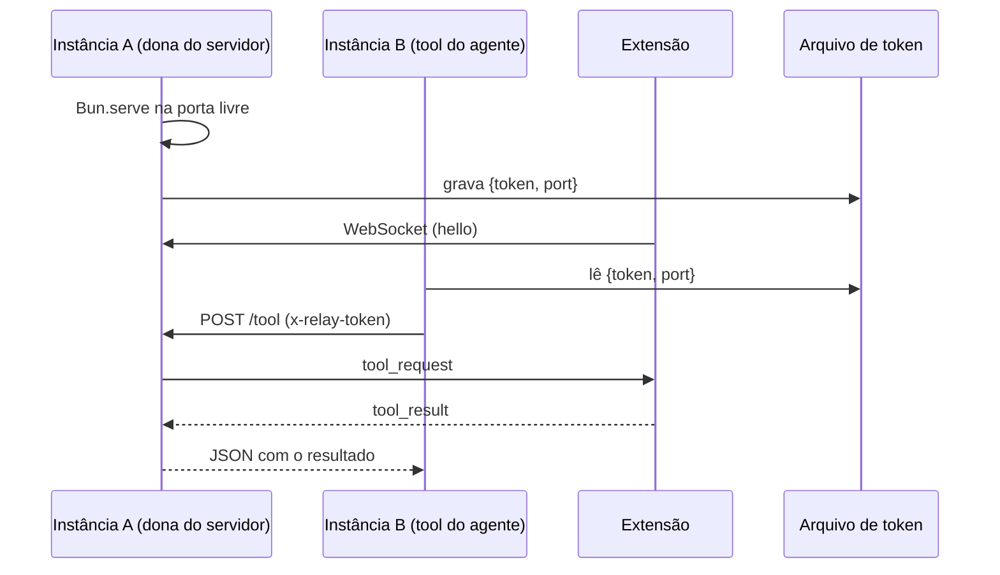

# Plugin do OpenCode (`browser-relay`)

Arquivo: `plugin/browser-relay.ts`
Instalação: `npm run install:plugin` copia para
`~/.config/opencode/plugins/browser-relay.ts` (e remove a cópia antiga
`opencode-browser.ts`, se existir).

> Mantenha **apenas uma** cópia do plugin em `~/.config/opencode/plugins/`.
> Duas cópias declaram o mesmo id `opencode.browser-relay` e o OpenCode
> registra uma delas como falha.

O OpenCode carrega plugins locais automaticamente e recarrega ao detectar
mudanças no arquivo.

## O que ele faz

1. Sobe um servidor WebSocket em loopback para receber a extensão.
2. Cria a pasta de conversas (`~/.opencode-browser-extensions`) e anuncia o
   `home` e o `workspace` no handshake `ready`.
3. Grava o agente `opencode-browser` em `<pasta de conversas>/.opencode/agents/`,
   com instruções de navegador e permissão apenas para `browser_*` (veja
   [Agente do navegador](#agente-do-navegador)).
4. Registra as 18 ferramentas `browser_*` no namespace `browser` (com
   `codemode: false`, para aparecerem na lista nativa de tools do modelo).
5. Quando o modelo chama uma ferramenta, envia um `tool_request` para a
   extensão e aguarda o `tool_result` (timeout de 180 s).
6. Converte imagens retornadas (base64) em conteúdo de arquivo para o modelo.

## Agente do navegador

O plugin grava (de forma idempotente) um agente primário chamado
`opencode-browser` no diretório da sessão:

```text
<workspace>/.opencode/agents/opencode-browser.md
```

O arquivo usa o frontmatter V2 do OpenCode:

```yaml
mode: primary
permissions:
  "*": deny
  "browser_*": allow
  question: allow
  doom_loop: ask
```

Na prática, o agente só enxerga as ferramentas do navegador e `question`:
`read`, `edit`, `bash`, `glob`, `grep`, `webfetch`, `task` e afins ficam
bloqueados, então ele não consegue mexer em arquivos ou dados da máquina fora
das páginas. O corpo do Markdown traz as instruções de operação (reutilizar a
aba do grupo, validar com `read_page`/console/rede, pedir confirmação antes de
ações destrutivas).

A extensão pede a gravação por `ensure_agent` sempre que o relay conecta ou o
diretório muda e, quando o agente aparece em `GET /api/agent`, passa a usá-lo
como padrão (`defaultAgent`) se o usuário ainda não escolheu outro.

> A descoberta de agentes é feita pelo OpenCode a partir do
> `location.directory` da sessão. Se o servidor não recarregar a lista sozinho,
> reinicie o `opencode` depois de atualizar o plugin.

## Plataformas

O plugin usa apenas APIs do Node/Bun (`os.homedir()`, `os.tmpdir()`,
`path.join`), então funciona igual em Linux, macOS e Windows. Os caminhos
envolvidos:

| Item | Linux | macOS | Windows |
|---|---|---|---|
| Plugins do OpenCode | `~/.config/opencode/plugins` | `~/.config/opencode/plugins` | `%USERPROFILE%\.config\opencode\plugins` |
| Pasta das conversas | `~/.opencode-browser-extensions` | `~/.opencode-browser-extensions` | `%USERPROFILE%\.opencode-browser-extensions` |
| Arquivo de token | `$TMPDIR/opencode-browser-relay.token` | `$TMPDIR/opencode-browser-relay.token` | `%TEMP%\opencode-browser-relay.token` |

`XDG_CONFIG_HOME`, `XDG_DATA_HOME`, `XDG_CACHE_HOME` e `XDG_STATE_HOME` são
respeitados quando definidos (em qualquer sistema). A instalação do plugin é
feita por `npm run install:plugin` (`scripts/install-plugin.mjs`), que resolve
esses caminhos sem depender de shell POSIX.

## Servidor local

| Rota | Método | Autenticação | Descrição |
|---|---|---|---|
| `/` ou `/ws` | `GET` (upgrade) | `Origin` da extensão | Canal WebSocket com a extensão |
| `/health` | `GET` | — | `{ "connected": true/false }` usado pela extensão para descobrir a porta ativa |
| `/tool` | `POST` | header `x-relay-token` | Executa uma ferramenta pelo dono do servidor (fallback entre instâncias) |
| `/cancel` | `POST` | header `x-relay-token` | Aborta uma chamada HTTP em andamento |

- **Portas:** tenta `8799`, `8800`, `8801` e `8802`, na ordem, até conseguir
  subir. A porta escolhida é publicada no arquivo de token.
- **Origem:** o upgrade só é aceito de `chrome-extension://<ID fixo>`; o ID pode
  ser trocado por `OPENCODE_BROWSER_EXTENSION_ID` ou liberado com
  `OPENCODE_BROWSER_ALLOW_ANY_EXTENSION=1`.
- **Token:** gerado uma vez e compartilhado entre instâncias pelo arquivo
  `/tmp/opencode-browser-relay.token` (modo `0600`), no formato
  `{"token":"…","port":8800}`.

## Múltiplas instâncias do plugin

O OpenCode pode carregar o mesmo plugin mais de uma vez (um contexto por
location/requisição), e cada instância tem seu próprio estado em memória. Sem
tratamento, uma instância registrava as ferramentas enquanto outra segurava o
socket da extensão — e as tools falhavam com "extensão não conectada".

Solução em duas camadas:

1. **Estado do servidor por processo:** o primeiro a subir mantém servidor,
   socket e chamadas pendentes; as demais instâncias reaproveitam a porta.
2. **Fallback HTTP:** uma instância sem socket envia `POST /tool` para a porta
   publicada no arquivo de token, com o token compartilhado. O dono do servidor
   executa e devolve o resultado; `/cancel` aborta.



Há também uma **versão do servidor** (`SERVER_VERSION`): quando o código do
relay muda de forma incompatível, a instância nova derruba o servidor antigo e
sobe um novo, evitando ficar presa em código velho após um reload.

## Ciclo de vida

- `setup(ctx)` incrementa um contador de instâncias e só sobe o servidor se não
  houver um; registra as ferramentas em `ctx.tool.transform`.
- O cleanup devolve o contador; quando chega a zero, rejeita chamadas pendentes
  e derruba o servidor que a instância criou.
- Se a porta estiver ocupada por um servidor antigo sem `/health`, a extensão
  descobre a nova porta pelo probe de `/health` em `8799–8802`.

## Variáveis de ambiente

| Variável | Padrão | Descrição |
|---|---|---|
| `OPENCODE_BROWSER_RELAY_PORT` | `8799` | Porta inicial da busca |
| `OPENCODE_BROWSER_EXTENSION_ID` | ID fixo do manifest | ID de extensão aceito na origem |
| `OPENCODE_BROWSER_ALLOW_ANY_EXTENSION` | `0` | `1` libera qualquer origem `chrome-extension://` |

## Protocolo

Mensagens da extensão para o plugin:

| Mensagem | Campos | Descrição |
|---|---|---|
| `hello` | `v`, `extensionId` | Identificação após conectar |
| `tool_result` | `id`, `ok`, `content?`, `images?`, `error?`, `metadata?` | Resultado da ferramenta |
| `progress` | `id`, `phase`, `detail?` | Progresso exibido no OpenCode |
| `pong` | — | Resposta ao `ping`; prova de vida |
| `ensure_agent` | `id`, `directory?` | Pede para gravar o agente `opencode-browser` no diretório da sessão |

Mensagens do plugin para a extensão:

| Mensagem | Campos | Descrição |
|---|---|---|
| `ready` | `v`, `home`, `workspace` | Handshake concluído; informa o home e a pasta de conversas. A extensão só marca o relay como conectado depois dele |
| `tool_request` | `id`, `tool`, `args`, `sessionID?` | Pedido de execução |
| `cancel` | `id` | Aborta uma execução |
| `ping` | — | Verificação de vida a cada 20 s; o plugin fecha o socket após 60 s sem `pong` |
| `ensure_agent_result` | `id`, `ok`, `path?`, `error?` | Confirma (ou não) a gravação do agente |

A extensão só arma o watchdog de silêncio depois de receber o primeiro `ping`,
então plugins antigos (que não pingam) continuam compatíveis. Quando armado, o
socket é fechado após 45 s sem nenhuma mensagem, com `reason: "silent"`.

O `sessionID` é o ID da sessão do OpenCode, usado pela extensão para isolar o
grupo de abas.

## Diagnóstico

```bash
# porta ativa e conexão
curl -s http://127.0.0.1:8800/health

# token e porta publicados
cat /tmp/opencode-browser-relay.token

# teste direto de uma tool (com token)
TOKEN=$(python3 -c "import json;print(json.load(open('/tmp/opencode-browser-relay.token'))['token'])")
curl -s -X POST http://127.0.0.1:8800/tool \
  -H "x-relay-token: $TOKEN" -H 'content-type: application/json' \
  -d '{"tool":"tabs_context","args":{"createIfEmpty":true},"sessionID":"debug"}'
```

Erros de carregamento aparecem no log do OpenCode
(`~/.local/share/opencode/log/opencode.log`), procurando por `failed to reload
plugins` ou `opencode-browser`.
