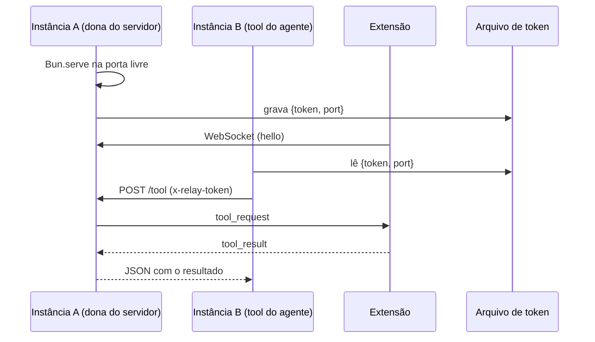

# Plugin do OpenCode (`browser-relay`)

Arquivo: `plugin/browser-relay.ts`
Instalação: `npm run install:plugin` copia o relay e o template
`opencode-browser.agent.md` para `~/.config/opencode/plugins/` (e remove a cópia
antiga `opencode-browser.ts`, se existir). Depois do install, reinicie o serviço
(`opencode service restart`) para carregar o relay e o agente novos.

> Mantenha **apenas uma** cópia do plugin em `~/.config/opencode/plugins/`.
> Duas cópias declaram o mesmo id `opencode.browser-relay` e o OpenCode
> registra uma delas como falha.

O OpenCode carrega plugins locais automaticamente e recarrega ao detectar
mudanças no arquivo.

## O que ele faz

1. Sobe um servidor WebSocket em loopback para receber a extensão.
2. Cria a pasta de conversas (`~/.opencode-browser-extensions`) e anuncia o
   `home` e o `workspace` no handshake `ready`, **depois** de um `hello` válido.
3. Garante o agente `opencode-browser` na configuração global do OpenCode
   (`~/.config/opencode/agents/`) a partir do template
   `plugin/opencode-browser.agent.md`, criando ou atualizando por versão (veja
   [Agente do navegador](#agente-do-navegador)).
4. Registra as 18 ferramentas `browser_*` no namespace `browser` (com
   `codemode: false`, para aparecerem na lista nativa de tools do modelo).
5. Quando o modelo chama uma ferramenta, envia um `tool_request` para a
   extensão e aguarda o `tool_result` (timeout de 180 s). Se a extensão estiver
   reconectando, espera até 8 s antes de falhar.
6. Converte imagens retornadas (base64) em conteúdo de arquivo para o modelo.

## Agente do navegador

O plugin cria o agente primário `opencode-browser` na configuração global do
OpenCode a partir do template `plugin/opencode-browser.agent.md`, que é
instalado ao lado do plugin. O arquivo é atualizado **por versão**:

- não existe → é criado a partir do template;
- tem o marcador `<!-- opencode-browser-agent vN -->` com versão menor que a do
  template → o plugin faz backup (`.bak-vN`) e grava a versão nova;
- não tem marcador (o usuário o removeu) ou já está na versão do template → é
  preservado, inclusive edições manuais.

O template atual é **v4** e inclui regras de segurança (prompt injection),
limitações do ambiente da extensão, abas por origem, economia de contexto e o
nome correto das ferramentas. Para personalizar, edite
`~/.config/opencode/agents/opencode-browser.md`; para voltar ao padrão, apague o
arquivo e reinicie o OpenCode.

> A ferramenta de fechar aba é `browser_tabs_close_tab` (wire `tabs_close`).
> O nome `browser_tabs_close` colide com `browser.tabs.close` do plugin nativo
> `opencode.browser` e desaparece do catálogo do modelo.

```text
~/.config/opencode/agents/opencode-browser.md            (Linux/macOS)
%USERPROFILE%\.config\opencode\agents\opencode-browser.md (Windows)
$XDG_CONFIG_HOME/opencode/agents/opencode-browser.md      (quando definido)
```

O arquivo usa o frontmatter V2 do OpenCode:

```yaml
mode: primary
permissions:
  - action: "*"
    resource: "*"
    effect: deny
  - action: "browser"
    resource: "*"
    effect: allow
  - action: "browser_*"
    resource: "*"
    effect: allow
  - action: question
    resource: "*"
    effect: allow
  - action: doom_loop
    resource: "*"
    effect: ask
```

Na prática, o agente só enxerga as ferramentas do navegador e `question`:
`read`, `edit`, `shell`, `glob`, `grep`, `webfetch` e afins ficam bloqueados,
então ele não consegue mexer em arquivos ou dados da máquina fora das páginas.
O corpo do Markdown (v4) traz segurança/prompt injection, limitações do
ambiente da extensão, abas por origem, economia de contexto e confirmação antes
de ações destrutivas.

A extensão pede a gravação por `ensure_agent` sempre que o relay conecta ou a
configuração muda e, quando o agente aparece em `GET /api/agent`, passa a usá-lo
como padrão (`defaultAgent`) se o usuário ainda não escolheu outro.

> Por ser global, o agente aparece em todos os projetos do OpenCode, não só nas
> conversas da extensão. Se o servidor não recarregar a lista sozinho, reinicie
> o `opencode` depois de atualizar o plugin.

## Plataformas

O plugin usa apenas APIs do Node/Bun (`os.homedir()`, `path.join`, `node:fs`,
`node:crypto`), então funciona igual em Linux, macOS e Windows. Os caminhos
envolvidos:

| Item | Linux | macOS | Windows |
|---|---|---|---|
| Plugins do OpenCode | `~/.config/opencode/plugins` | `~/.config/opencode/plugins` | `%USERPROFILE%\.config\opencode\plugins` |
| Agentes do OpenCode | `~/.config/opencode/agents` | `~/.config/opencode/agents` | `%USERPROFILE%\.config\opencode\agents` |
| Pasta das conversas | `~/.opencode-browser-extensions` | `~/.opencode-browser-extensions` | `%USERPROFILE%\.opencode-browser-extensions` |
| Arquivo de token | `$XDG_RUNTIME_DIR/opencode-browser/relay.json` ou `~/.cache/opencode-browser/relay.json` | idem | `%USERPROFILE%\.cache\opencode-browser\relay.json` |

`XDG_CONFIG_HOME`, `XDG_DATA_HOME`, `XDG_CACHE_HOME`, `XDG_STATE_HOME` e
`XDG_RUNTIME_DIR` são respeitados quando definidos (em qualquer sistema). A
instalação do plugin é feita por `npm run install:plugin`
(`scripts/install-plugin.mjs`), que resolve esses caminhos sem depender de shell
POSIX.

## Servidor local

| Rota | Método | Autenticação | Descrição |
|---|---|---|---|
| `/` ou `/ws` | `GET` (upgrade) | `Origin` da extensão + `hello` | Canal WebSocket com a extensão |
| `/health` | `GET` | `Host` loopback | `{ "connected": true/false, "version": 6 }`; sem caminhos locais, usado pela extensão para descobrir a porta ativa |
| `/tool` | `POST` | header `x-relay-token` | Executa uma ferramenta pelo dono do servidor (fallback entre instâncias) |
| `/cancel` | `POST` | header `x-relay-token` | Aborta uma chamada HTTP em andamento |

- **Portas:** tenta `8799`, `8800`, `8801` e `8802`, na ordem. Se a porta já
  estiver ocupada por outro relay, este processo **reutiliza** o relay existente
  via HTTP em vez de subir um segundo servidor. A porta escolhida é publicada no
  arquivo de token.
- **Handshake:** o socket só vira ativo depois de um `hello` válido (timeout de
  5 s). Um socket não autenticado não recebe `ready` nem pode responder
  `tool_result`. `OPENCODE_BROWSER_REQUIRE_HELLO=0` desliga a exigência.
- **Origem:** o upgrade só é aceito de `chrome-extension://<ID fixo>`; o ID pode
  ser trocado por `OPENCODE_BROWSER_EXTENSION_ID` ou liberado com
  `OPENCODE_BROWSER_ALLOW_ANY_EXTENSION=1`.
- **Token:** gerado por processo e compartilhado entre instâncias pelo arquivo
  privado `$XDG_RUNTIME_DIR/opencode-browser/relay.json` (ou
  `~/.cache/opencode-browser/relay.json`), pasta `0700` e arquivo `0600`, no
  formato `{"token":"…","port":8800}`. O dono e as permissões são conferidos ao
  ler; a escrita é atômica.
- **Limites:** corpo HTTP de 1 MB, payload WebSocket de 24 MB e imagens de até
  8 MB em base64 (PNG/JPEG/GIF/WebP, no máximo 3).
- **Reconexão:** se a extensão (service worker MV3) estiver dormindo, as
  chamadas esperam até 8 s por ela antes de devolver erro.

## Múltiplas instâncias do plugin

O OpenCode pode carregar o mesmo plugin mais de uma vez (um contexto por
location/requisição), e cada instância tem seu próprio estado em memória. Sem
tratamento, uma instância registrava as ferramentas enquanto outra segurava o
socket da extensão — e as tools falhavam com "extensão não conectada".

Solução em duas camadas:

1. **Estado do servidor por processo:** o primeiro a subir mantém servidor,
   socket e chamadas pendentes; as demais instâncias reaproveitam a porta. Se a
   porta já pertence a outro processo do OpenCode com relay, o processo novo
   vira cliente HTTP dele em vez de subir um segundo servidor.
2. **Fallback HTTP:** uma instância sem socket envia `POST /tool` para a porta
   publicada no arquivo de token, com o token compartilhado. O dono do servidor
   executa e devolve o resultado; `/cancel` aborta.
3. **Espera pela reconexão:** quando a extensão está reconectando, o relay
   espera até 8 s (`EXTENSION_GRACE_MS`) antes de responder 503.



Há também uma **versão do servidor** (`SERVER_VERSION`, atualmente `6`): quando
o código do relay muda de forma incompatível, a instância nova derruba o
servidor antigo e sobe um novo, evitando ficar presa em código velho após um
reload.

## Ciclo de vida

- `setup(ctx)` incrementa um contador de instâncias e só sobe o servidor se não
  houver um; registra as ferramentas em `ctx.tool.transform`.
- O cleanup devolve o contador; quando chega a zero, rejeita chamadas pendentes
  e derruba o servidor — mesmo que outra instância o tenha criado —, removendo o
  arquivo de token se ele pertencer a este processo.
- Se a porta estiver ocupada por um relay existente, o processo novo reutiliza
  esse relay via HTTP; se não houver relay, tenta a próxima porta candidata.

## Variáveis de ambiente

| Variável | Padrão | Descrição |
|---|---|---|
| `OPENCODE_BROWSER_RELAY_PORT` | `8799` | Porta inicial da busca |
| `OPENCODE_BROWSER_EXTENSION_ID` | ID fixo do manifest | ID de extensão aceito na origem |
| `OPENCODE_BROWSER_ALLOW_ANY_EXTENSION` | `0` | `1` libera qualquer origem `chrome-extension://` |
| `OPENCODE_BROWSER_REQUIRE_HELLO` | `1` | `0` desliga a exigência de `hello` (não recomendado) |
| `OPENCODE_BROWSER_WS_SECRET` | vazio | Segredo opcional exigido no `hello`; a extensão atual não o envia, use só com uma extensão adaptada |

## Protocolo

Mensagens da extensão para o plugin:

| Mensagem | Campos | Descrição |
|---|---|---|
| `hello` | `v`, `extensionId`, `secret?` | Identificação após conectar; obrigatória para ativar o socket |
| `tool_result` | `id`, `ok`, `content?`, `images?`, `error?`, `metadata?` | Resultado da ferramenta |
| `progress` | `id`, `phase`, `detail?` | Progresso exibido no OpenCode |
| `pong` | — | Resposta ao `ping`; prova de vida |
| `ensure_agent` | `id` | Pede para gravar/atualizar o agente `opencode-browser` |

Mensagens do plugin para a extensão:

| Mensagem | Campos | Descrição |
|---|---|---|
| `ready` | `v`, `home`, `workspace` | Handshake concluído, enviado só depois do `hello`; informa o home e a pasta de conversas |
| `tool_request` | `id`, `tool`, `args`, `sessionID?` | Pedido de execução |
| `cancel` | `id` | Aborta uma execução |
| `ping` | — | Verificação de vida a cada 20 s; o plugin fecha o socket após 60 s sem `pong` |
| `ensure_agent_result` | `id`, `ok`, `path?`, `error?` | Confirma (ou não) a gravação/atualização do agente |

A extensão só arma o watchdog de silêncio depois de receber o primeiro `ping`,
então plugins antigos (que não pingam) continuam compatíveis. Quando armado, o
socket é fechado após 45 s sem nenhuma mensagem, com `reason: "silent"`.

O `sessionID` é o ID da sessão do OpenCode, usado pela extensão para isolar o
grupo de abas.

## Diagnóstico

```bash
# porta ativa e conexão
curl -s http://127.0.0.1:8799/health

# token e porta publicados (XDG_RUNTIME_DIR tem precedência)
cat "${XDG_RUNTIME_DIR:-$HOME/.cache}/opencode-browser/relay.json"

# teste direto de uma tool (com token)
TOKEN=$(python3 -c "import json,os;print(json.load(open(os.path.join(os.environ.get('XDG_RUNTIME_DIR', os.path.expanduser('~/.cache')), 'opencode-browser', 'relay.json')))['token'])")
curl -s -X POST http://127.0.0.1:8799/tool \
  -H "x-relay-token: $TOKEN" -H 'content-type: application/json' \
  -d '{"tool":"tabs_context","args":{"createIfEmpty":true},"sessionID":"debug"}'
```

Erros de carregamento aparecem no log do OpenCode
(`~/.local/share/opencode/log/opencode.log`), procurando por `failed to reload
plugins` ou `opencode-browser`.
